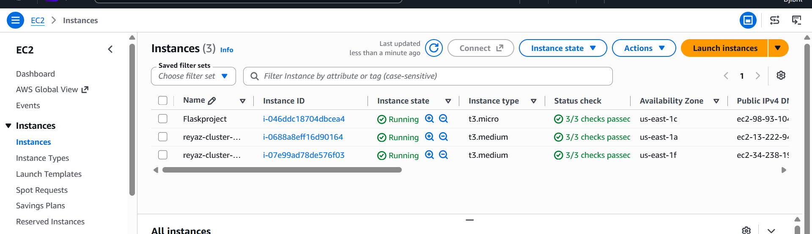
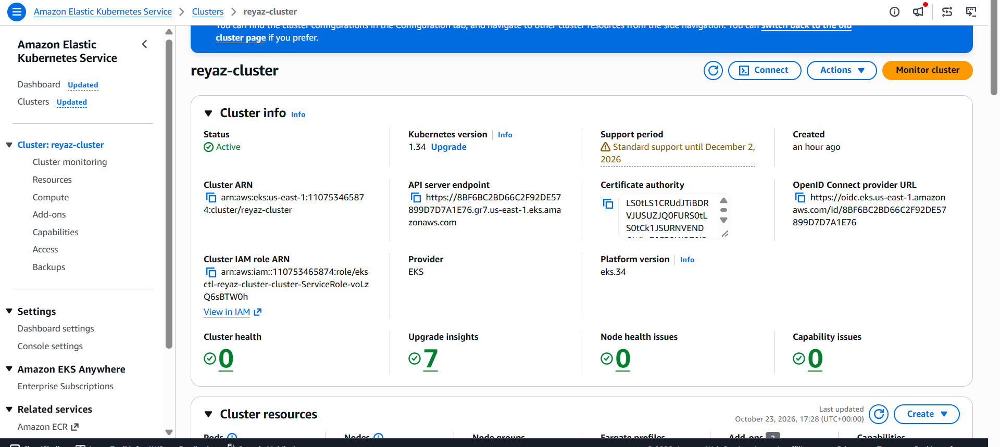
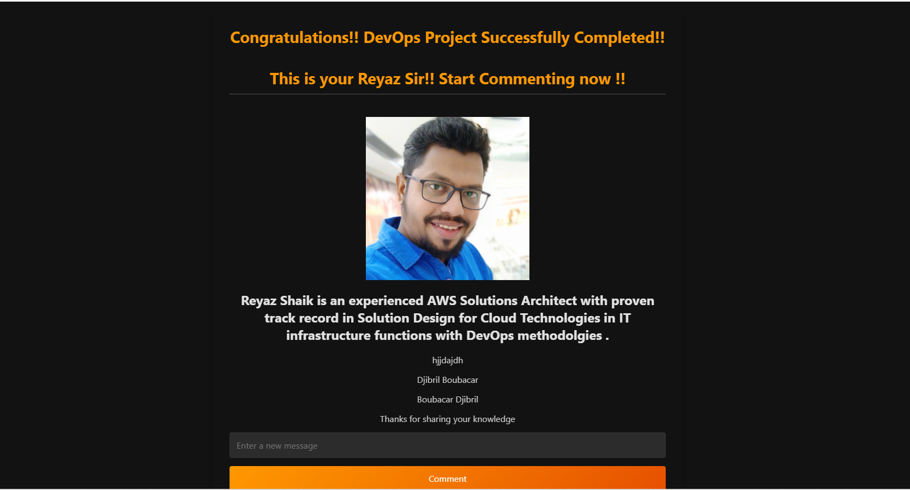

# 🚀 Flask + MySQL on Amazon EKS — DevOps Project

A hands-on DevOps project demonstrating how to deploy a two-tier web application built with **Python Flask and MySQL** on **Amazon Elastic Kubernetes Service (EKS)** using AWS CLI, `kubectl`, and `eksctl`.

## 📐 Project Architecture


### Architecture Components

- **Amazon EC2 (Amazon Linux 2):** Administration host for managing AWS resources and deploying the application.
- **Amazon EKS:** Managed Kubernetes control plane and worker nodes.
- **Flask Application:** Python web application deployed in Kubernetes.
- **MySQL Database:** Database backend managed through Kubernetes Deployments, Secrets, ConfigMaps, and persistent storage where configured.
- **Kubernetes Services:** Enable communication between Flask and MySQL and expose the web application.
- **AWS CLI, kubectl and eksctl:** Tools for AWS authentication, Kubernetes administration, and cluster provisioning.

## 📁 Project Structure

```text
EksFlaskMysqlProject/
├── eks-manifests/
│   ├── mysql-secrets.yml
│   ├── mysql-configmap.yml
│   ├── mysql-deployment.yml
│   ├── mysql-svc.yml
│   ├── two-tier-app-deployment.yml
│   └── two-tier-app-svc.yml
├── static/
├── templates/
├── app.py
├── Dockerfile
├── requirements.txt
├── message.sql
├── Guide.txt
├── Architecture DevOps avec EKS, Flask et MySQL.png
├── Ec2s.png
├── EKS.png
└── Result.png
```

*The structure above assumes these files and directories exist in your repository.*

## 🛠️ Prerequisites

Before starting, make sure you have:

- An active AWS account with the required IAM permissions.
- An EC2 instance running Amazon Linux 2.
- AWS CLI v2 installed and configured, preferably using an attached IAM role.
- `kubectl` compatible with the target EKS Kubernetes version.
- `eksctl` installed.
- Git installed.
- A working Flask application and a Docker image available to Kubernetes.

> **Security:** Avoid committing AWS credentials, database passwords, or unencrypted Kubernetes Secrets to GitHub. Use IAM roles and appropriate secret-management practices.

## 🚀 Deployment Guide

### 1. Configure AWS CLI

Verify the installation and AWS identity:

```bash
aws --version
aws sts get-caller-identity
```

If you use an IAM role attached to EC2, you generally do not need to run `aws configure`.

### 2. Install kubectl

The following commands assume an x86-64 EC2 instance. Select a `kubectl` version compatible with your EKS cluster.

```bash
sudo yum update -y
sudo yum install -y curl

# Replace v1.XX.0 with a supported Kubernetes version
K8S_VERSION="v1.XX.0"

curl -fLO "https://dl.k8s.io/release/${K8S_VERSION}/bin/linux/amd64/kubectl"

chmod +x kubectl
mkdir -p "$HOME/bin"
install -m 0755 kubectl "$HOME/bin/kubectl"

grep -qxF 'export PATH="$HOME/bin:$PATH"' ~/.bashrc ||
  echo 'export PATH="$HOME/bin:$PATH"' >> ~/.bashrc

export PATH="$HOME/bin:$PATH"

kubectl version --client
```

Consult the [official EKS Kubernetes version documentation](https://docs.aws.amazon.com/eks/latest/userguide/kubernetes-versions.html) to select a compatible version.

### 3. Install eksctl

```bash
ARCH=amd64
PLATFORM="$(uname -s)_${ARCH}"

curl -sLO "https://github.com/eksctl-io/eksctl/releases/latest/download/eksctl_${PLATFORM}.tar.gz"

tar -xzf "eksctl_${PLATFORM}.tar.gz" -C /tmp
sudo install -m 0755 /tmp/eksctl /usr/local/bin/eksctl

eksctl version
```

### 4. Create the EKS Cluster

This example uses the AWS Mumbai region (`ap-south-1`) and two worker nodes.

```bash
eksctl create cluster \
  --name reyaz-cluster \
  --region ap-south-1 \
  --node-type t3.medium \
  --nodes 2 \
  --nodes-min 2 \
  --nodes-max 3
```

**Cost note:** EKS control-plane charges and worker-node charges apply. Check current AWS pricing before creating the cluster. The selected instance type must also be supported by the chosen EKS version and node configuration.

### 5. Configure kubectl Access

Generate or update the Kubernetes configuration:

```bash
aws eks update-kubeconfig \
  --name reyaz-cluster \
  --region ap-south-1

kubectl config current-context
kubectl get nodes
kubectl get pods -A
```

#### Troubleshooting: `invalid apiVersion client.authentication.k8s.io/v1alpha1`

This error commonly indicates an obsolete authentication configuration or an outdated AWS CLI setup.

1. Verify that AWS CLI v2 is installed.
2. Update AWS CLI if necessary.
3. Regenerate the configuration using `aws eks update-kubeconfig`.
4. Check that `kubectl` is compatible with the cluster version.
5. Retry `kubectl get nodes`.

Do not downgrade to Kubernetes 1.23.15 as a general fix; it is an obsolete version and does not address the underlying configuration issue reliably.

### 6. Deploy MySQL

Apply the database configuration before deploying the Flask application:

```bash
kubectl apply -f eks-manifests/mysql-secrets.yml
kubectl apply -f eks-manifests/mysql-configmap.yml
kubectl apply -f eks-manifests/mysql-deployment.yml
kubectl apply -f eks-manifests/mysql-svc.yml
```

Verify the MySQL resources:

```bash
kubectl get pods
kubectl get services
kubectl logs deployment/mysql
```

The log command assumes the Deployment is named `mysql`. Adapt it if your manifest uses a different name.

### 7. Deploy the Flask Application

```bash
kubectl apply -f eks-manifests/two-tier-app-deployment.yml
kubectl apply -f eks-manifests/two-tier-app-svc.yml
```

Check the deployment status:

```bash
kubectl get deployments
kubectl get pods
kubectl get services
kubectl get events --sort-by=.metadata.creationTimestamp
```

Ensure the Flask application connects to the MySQL Service using the correct internal DNS name, port, database name, username, and password.

### 8. Access the Application

Inspect the Service type and its assigned address:

```bash
kubectl get svc
```

If the application Service is configured as `LoadBalancer`, wait for AWS to provision the external endpoint:

```bash
kubectl get svc two-tier-app-service -w
```

Once an external address appears, open it in your browser using the appropriate protocol and port.

If you use `NodePort` instead, configure network access appropriately and use a valid reachable node address and NodePort. A `ClusterIP` Service alone does not expose the application publicly.

## 📊 Screenshots and Results

Add screenshots from your actual deployment to document the results.

| EC2 Instance | EKS Cluster | Application |
|---|---|---|
|  |  |  |

## 🧹 Clean Up AWS Resources

When testing is complete, remove the cluster to avoid unnecessary charges.

First, make sure you have backed up any data you want to keep.

```bash
eksctl delete cluster \
  --name reyaz-cluster \
  --region ap-south-1
```

Verify that any associated load balancers, persistent volumes, EBS volumes, snapshots, and other billable resources have been handled appropriately.

## 🔐 Security and Reliability Notes

- Keep database credentials out of source code and public repositories.
- Use least-privilege IAM permissions.
- Configure persistent storage if MySQL data must survive pod replacement.
- Use readiness and liveness probes where appropriate.
- Confirm that MySQL is not exposed publicly.
- Consider Amazon ECR and a CI/CD pipeline for automated image builds and deployments.

## 👨‍💻 Author

**Boubacar Djibrilla**

Software Engineer | AWS Cloud | DevOps | Kubernetes

GitHub: [@boubacardjibrilla](https://github.com/boubacardjibrilla)

---

*This project is a practical learning exercise in AWS infrastructure, container orchestration, and Kubernetes application deployment.*
